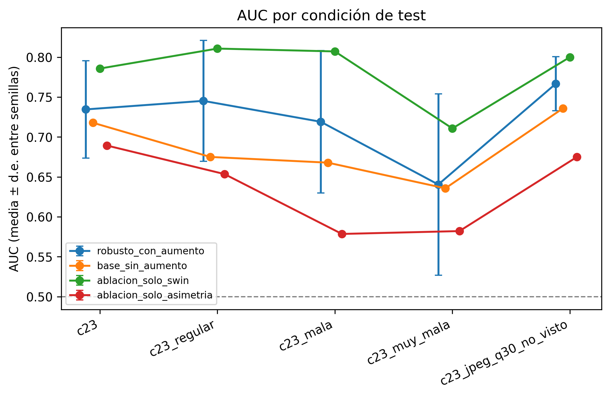

# Detección de deepfakes con Swin Transformer y asimetría diferencial lateral

Código de la tesis sobre detección de rostros manipulados en video robusta a la pérdida de calidad.
El detector combina dos ramas: un Swin Transformer que analiza el rostro completo y una CNN que analiza
el mapa de diferencias entre la mitad izquierda (en espejo) y la mitad derecha del rostro.

Todas las redes (Swin-T, CNN, MLP), sus gradientes y el optimizador están implementados en NumPy/CuPy,
sin PyTorch ni TensorFlow. En GPU se usa CuPy y en CPU NumPy, con el mismo código.

## Pipeline


El rostro del diagrama es un fotograma del video 003 de FaceForensics++ (Rössler et al., 2019).
Lo que cambió respecto al diseño inicial:

| Paso | Diseño inicial | Implementación actual | Motivo |
|---|---|---|---|
| Swin Transformer | pesos aleatorios | pesos iniciales de ImageNet-1k (Swin-T) | entrenado desde cero con 200 videos el AUC quedó en 0.50 |
| Mapa de asimetría | resta de píxeles | resta de residuos de textura, cada mitad normalizada por separado | la resta de píxeles respondía a la iluminación y la pose |
| Detección de rostro | MediaPipe | MediaPipe + detector de respaldo para rostros pequeños | dos videos sin rostro detectado |
| Alineación | recorte de al menos 224 px | recorte proporcional al rostro | rostros pequeños quedaban descentrados |
| Entrenamiento | sin aumento | aumento de calidad y normalización robusta (mediana/IQR del train) | robustez a baja calidad |

## Estructura

```
deteccion-deepfakes-swin/
├── README.md
├── requirements.txt
├── .gitignore
├── src/          código del detector, del entrenamiento y de los análisis
├── notebooks/    notebooks para correr el pipeline y las pruebas
├── kaggle/       scripts y notebooks para ejecutar en Kaggle
└── docs/         diagrama, resultados, diagnóstico y figuras de las pruebas
```

### Archivos de la raíz

| Archivo | Qué hace |
|---|---|
| `README.md` | este documento |
| `requirements.txt` | librerías de Python necesarias (`pip install -r requirements.txt`) |
| `.gitignore` | evita subir videos, rostros extraídos, pesos y salidas de entrenamiento (FF++ no se puede redistribuir) |

### `src/`: código fuente

Modelo, implementado con NumPy/CuPy:

| Archivo | Qué hace |
|---|---|
| `backend.py` | elige CuPy si hay GPU o NumPy si no, fija las semillas (42) y la precisión (float32) |
| `layers.py` | capas con forward y backward escritos a mano: Linear, ReLU, GELU, Dropout, LayerNorm, BatchNorm2d, Conv2d, MaxPool2d, promedio global y softmax |
| `swin.py` | Swin Transformer Tiny: PatchEmbed, partición en ventanas, Window Attention con sesgo de posición relativa, ventanas desplazadas con su máscara, Patch Merging y la proyección 768 → 256 |
| `cnn.py` | CNN de la rama lateral: 3 bloques convolucionales (32, 64, 128 canales) y proyección a 256 |
| `mlp.py` | clasificador final: 512 → 256 → 2 con ReLU y Dropout |
| `detector.py` | une las dos ramas: concatena los vectores (512), aplica Branch Dropout, clasifica y promedia los 16 fotogramas de un video; también permite apagar una rama para las ablaciones |
| `losses.py` | Focal Loss con su gradiente |
| `optim.py` | optimizadores SGD y AdamW, recorte del gradiente y tasa de aprendizaje coseno |
| `pretrained.py` | descarga los pesos ImageNet de Swin-T desde Hugging Face, los lee (formato safetensors, sin PyTorch) y los carga en `swin.py` |

Datos y preprocesamiento:

| Archivo | Qué hace |
|---|---|
| `data.py` | lista los videos, agrupa por identidad, hace la partición sin fugas, muestrea 16 fotogramas, detecta y alinea el rostro con MediaPipe (con respaldo Haar), calcula el índice de giro y guarda la caché de rostros |
| `ff_splits.py` | lista oficial de pares de videos de FF++ para train, val y test (720/140/140) |
| `augment.py` | mapa de asimetría (por píxeles o por residuos de textura), degradaciones de calidad, aumento de datos y normalización robusta |

Entrenamiento y evaluación:

| Archivo | Qué hace |
|---|---|
| `trainer.py` | bucle de entrenamiento: arma los lotes, aplica aumento y normalización, entrena con AdamW, valida por video, hace parada temprana y guarda el mejor modelo |
| `metrics.py` | AUC, F1, precisión, recall, EER, matriz de confusión, umbral de Youden, intervalos de confianza por bootstrap y comparaciones pareadas; también las figuras (300 dpi) |
| `experimento.py` | el protocolo completo en tres fases: preprocesar, entrenar y evaluar un modelo, y analizar todos los resultados juntos |

Verificación y diagnóstico:

| Archivo | Qué hace |
|---|---|
| `gradcheck.py` | compara cada gradiente escrito a mano con diferencias finitas (32 verificaciones) y revisa las dimensiones con los tamaños reales |
| `verificar_swin_timm.py` | comprueba que `swin.py` da la misma salida que el Swin-T de la librería timm con los mismos pesos (necesita PyTorch y timm) |
| `verificar_dataset.py` | revisa el dataset: formato de los videos, fotogramas, duplicados, fugas entre conjuntos y detección de rostros |
| `diagnostico_asimetria.py` | analiza qué mide el mapa de asimetría (relación con el giro y el brillo, y una sonda lineal) sin entrenar redes |

Generadores:

| Archivo | Qué hace |
|---|---|
| `build_notebook.py` | genera `notebooks/deepfake_kaggle.ipynb` y `notebooks/smoke_test_kaggle.ipynb` a partir de los módulos |
| `build_fases.py` | genera los notebooks de las tres fases de Kaggle (`kaggle/notebooks_ffpp*`) |
| `build_pruebas.py` | genera `notebooks/pruebas_por_partes.ipynb` |
| `dibujar_pipeline.py` | dibuja `docs/pipeline.png` a partir de un video |

Los notebooks de Kaggle llevan el código de los módulos dentro, para que funcionen solos. Si se cambia algo en
`src/`, hay que volver a generarlos:

```bash
cd src
python build_notebook.py . ../notebooks/deepfake_kaggle.ipynb auto
python build_notebook.py . ../notebooks/smoke_test_kaggle.ipynb smoke
python build_fases.py . ../kaggle/notebooks_ffpp
python build_fases.py . ../kaggle/notebooks_ffpp_smoke --smoke
python build_pruebas.py ../notebooks/pruebas_por_partes.ipynb
```

### `notebooks/`

| Archivo | Qué hace |
|---|---|
| `pruebas_por_partes.ipynb` | prueba cada componente por separado (ver la sección Pruebas por partes) |
| `deepfake_kaggle.ipynb` | versión en un solo notebook: preprocesa, entrena los cuatro modelos seguidos y evalúa; la usa `kaggle/subir_a_kaggle.sh` |
| `smoke_test_kaggle.ipynb` | el mismo notebook con 6 videos y 1 época, para comprobar que todo corre antes de gastar GPU |

### `kaggle/`

| Archivo | Qué hace |
|---|---|
| `ejecutar_ffpp.sh` | ejecuta el protocolo final en Kaggle: sube los notebooks de las tres fases, espera a que terminen y descarga los resultados en `salida_ffpp/` |
| `subir_a_kaggle.sh` | sube el dataset y ejecuta `deepfake_kaggle.ipynb` (o el smoke test) en una sola sesión de GPU |
| `notebooks_ffpp/fase1_preproceso.ipynb` | fase 1 (CPU): extrae y alinea los rostros, hace la partición oficial y ajusta la normalización con train |
| `notebooks_ffpp/fase2_entrenar.ipynb` | fase 2 (GPU): plantilla que entrena un modelo con una semilla; el script reemplaza `__EXPERIMENTO__` y `__SEMILLA__` |
| `notebooks_ffpp/fase3_analisis.ipynb` | fase 3 (CPU): junta las puntuaciones de todos los modelos y calcula tablas, intervalos y figuras |
| `notebooks_ffpp_smoke/` | las mismas tres fases con 10 videos por conjunto y 1 época |

### `docs/`

| Archivo o carpeta | Contenido |
|---|---|
| `pipeline.png` | diagrama del pipeline implementado |
| `resultados/auc_resumen.csv` | AUC por modelo y condición de calidad (media entre semillas) |
| `resultados/auc_por_semilla.csv` | AUC de cada semilla con su intervalo de confianza del 95 % |
| `resultados/metricas_con_umbral.csv` | exactitud, precisión, recall, F1, EER y matriz de confusión con el umbral fijado en validación |
| `resultados/comparaciones_pareadas.csv` | diferencias de AUC entre modelos sobre los mismos videos, con intervalo y p-valor |
| `resultados/fig_auc_por_condicion.png` | gráfico del AUC de cada modelo según la calidad |
| `diagnostico_asimetria/` | resultados de `diagnostico_asimetria.py`: correlaciones con giro y brillo, sonda lineal por partición y dos figuras |
| `pruebas/` | figuras y tabla resumen de `pruebas_por_partes.ipynb` |

## Instalación

```bash
python3 -m venv .venv && source .venv/bin/activate
pip install -r requirements.txt
# opcional, GPU NVIDIA con CUDA 12:
pip install cupy-cuda12x
```

Comprobar que los gradientes son correctos (menos de un minuto en CPU):

```bash
cd src && DF_BACKEND=numpy python gradcheck.py
```

## Pruebas por partes

[`notebooks/pruebas_por_partes.ipynb`](notebooks/pruebas_por_partes.ipynb) prueba cada componente por separado,
en el orden en que los datos recorren el pipeline. Cada sección imprime las dimensiones de los tensores y
termina con una comprobación `OK` o `FALLA`:

| # | Parte | Qué se comprueba |
|---|---|---|
| 1 | Preprocesamiento | rostro de 224×224×3 con valores en [0, 1] |
| 2 | Mapa diferencial | forma 224×112; un rostro simétrico da un mapa nulo; una alteración en una sola mejilla aparece justo en esa zona |
| 3 | PatchEmbed | (1, 3, 224, 224) → (1, 3136, 96); rechaza otras resoluciones |
| 4 | Partición en ventanas | 64 ventanas de 7×7; la reconstrucción es exacta |
| 5 | Ventanas desplazadas | máscara (64, 49, 49) con valores 0 y −100 |
| 6 | Window Attention | las filas de atención suman 1; la máscara bloquea regiones no contiguas |
| 7 | Patch Merging | 56×56×96 → 28×28×192 → 14×14×384 → 7×7×768 |
| 8 | Swin completo | forma de salida en cada bloque, vector 768 → 256, 27.5 M de parámetros |
| 9 | CNN lateral | (1, 3, 224, 112) → (1, 256), bloque por bloque |
| 10 | Fusión y Branch Dropout | vector de 512; cada rama se apaga ≈5 % de las veces y nunca en evaluación |
| 11 | MLP | 512 → 2; softmax suma 1; dropout solo en entrenamiento |
| 12 | Focal Loss | igual a la entropía cruzada con γ = 0; gradiente analítico = numérico; estable con logits extremos |
| 13 | Detector completo | forward y backward, ablaciones, máscara por giro y promedio de 16 fotogramas por video |
| 14 | Aprendizaje | con 16 ejemplos el modelo los memoriza (la pérdida baja y acierta el 100 %) |
| 15 | Calidad y normalización | degradación creciente por nivel; estadísticos calculados solo con train |
| 16 | Partición | 0 identidades compartidas entre train, val y test; reproducible con semilla 42 |
| 17 | Métricas | AUC, F1, precisión, recall, EER, matriz de confusión e intervalo bootstrap |
| 18 | Gradientes | backpropagation manual contra diferencias finitas (32 verificaciones) |

El notebook guardado ya tiene las salidas: **20 de 20 pruebas superadas** en CPU, en unos 2 minutos.
Las figuras están en [`docs/pruebas/`](docs/pruebas/).

Las salidas guardadas usan el video original 003 de FaceForensics++ (calidad c40): MediaPipe alinea un
fotograma real y ese rostro recorre todo el pipeline; la prueba de aprendizaje usa 8 fotogramas del mismo video.
Para repetirlo se indican el video y el modelo de MediaPipe con dos variables de entorno. Sin ellas, el notebook
usa un rostro sintético dibujado en código. Con `CARGAR_IMAGENET = True` la sección 8 carga los pesos de Swin-T.

```bash
pip install jupyter
cd notebooks
RUTA_ROSTRO=/ruta/a/original_sequences/youtube/c40/videos/003.mp4 \
RUTA_LANDMARKER=/ruta/a/face_landmarker.task \
DF_BACKEND=numpy jupyter notebook pruebas_por_partes.ipynb
```

En Kaggle basta con una celda inicial `!git clone https://github.com/JhonatanBilbao/deteccion-deepfakes-swin`
y abrir el notebook desde esa carpeta (busca `src/` automáticamente).

## Datos

No se incluyen videos. Se usa FaceForensics++ (Rössler et al., 2019), que se solicita a sus autores en
https://github.com/ondyari/FaceForensics. Se aceptan dos estructuras:

```
dataset/real/000.mp4                      dataset/original_sequences/youtube/c23/videos/000.mp4
dataset/fake/Deepfakes_000_003.mp4   o    dataset/manipulated_sequences/Deepfakes/c23/videos/000_003.mp4
```

La partición es la oficial de FF++ (720/140/140 videos originales): todos los videos de una persona,
reales y manipulados, quedan en el mismo conjunto. La normalización se ajusta solo con el train.
Si el dataset incluye la versión c40, sus videos de test se usan como prueba de baja calidad real.
Opcionalmente se evalúa en el test oficial de Celeb-DF v2.

Auditoría del dataset:

```bash
python src/verificar_dataset.py ruta/al/dataset
```

## Ejecución en Kaggle

Los resultados se obtuvieron en Kaggle, con la cuenta `jhonatanbilbaouscca` y el dataset privado
`deepfake-ffpp-tesis` (el subconjunto de FF++ descrito en Resultados).

### Entorno

| | |
|---|---|
| GPU | 1 NVIDIA Tesla T4 de 16 GB (acelerador `NvidiaTeslaT4`) |
| Fases sin GPU | CPU de Kaggle, no consumen cuota de GPU |
| Python | 3.13 (imagen de Kaggle); CuPy en GPU, NumPy en CPU |
| Internet | activado: instala MediaPipe y CuPy, descarga `face_landmarker.task` y los pesos de Swin-T de Hugging Face |
| Límites de Kaggle | sesiones de hasta 12 h y una cuota semanal de GPU (unas 30 h; el saldo se ve en la cuenta) |
| Kernels | privados; cada fase lee la salida de la anterior con `kernel_sources` |

La cuenta de Kaggle debe tener el teléfono verificado; sin eso no se puede activar la GPU ni internet.

### Cómo se ejecutó

El entrenamiento se separó en tres fases para no gastar GPU en lo que no la necesita y para que cada
modelo tenga su propia sesión (si una falla, las demás no se pierden):

| Fase | Kernel | Hardware | Qué hace | Salida |
|---|---|---|---|---|
| 1 | `deepfake-ffpp-fase1-preproceso` | CPU | muestrea 16 fotogramas por video, alinea los rostros, aplica la partición oficial y ajusta la normalización con train | caché de rostros en memoria mapeada (`faces.npy`, `meta.npz`) y estadísticos de normalización |
| 2 | `deepfake-ffpp-f2-<modelo>-s<semilla>` (6 kernels) | GPU T4 | entrena un modelo y guarda la puntuación de cada video de test en cada condición de calidad | `scores_<modelo>_s<semilla>.csv` |
| 3 | `deepfake-ffpp-fase3-analisis` | CPU | junta las 6 puntuaciones, calcula AUC con intervalos bootstrap, comparaciones pareadas y figuras | `analisis/tablas/*.csv` y `analisis/figuras/*.png` |

Los 6 kernels de la fase 2 son: el modelo propuesto con las semillas 42, 7 y 123, y el modelo base, solo Swin
y solo asimetría con la semilla 42. Las fases 1 y 2 tienen un límite de 12 h por kernel y la fase 3 de 2 h.
Como referencia de tiempos: la ablación de solo asimetría tardó unos 5 minutos, y en una corrida anterior con
el mismo hardware cada modelo con Swin tardó entre 18 y 20 minutos.

`kaggle/ejecutar_ffpp.sh` hace todo desde la terminal: genera los kernels, los sube con la CLI, revisa su
estado cada minuto, encadena las fases y al final descarga los resultados en `salida_ffpp/`.

### Cómo usarlo

1. Instalar la CLI de Kaggle en un entorno virtual (en Ubuntu, pip no deja instalar paquetes en el sistema):

   ```bash
   python3 -m venv ~/.venvs/kaggle
   ~/.venvs/kaggle/bin/pip install kaggle six
   echo 'export PATH="$HOME/.venvs/kaggle/bin:$PATH"' >> ~/.bashrc && source ~/.bashrc
   ```

2. Iniciar sesión (abre el navegador; la sesión queda guardada en tu usuario, fuera del repositorio):

   ```bash
   kaggle auth login
   export KAGGLE_USERNAME=tu_usuario
   ```

3. Subir FF++ como dataset privado, solo la primera vez (puede tardar horas según la conexión):

   ```bash
   bash kaggle/ejecutar_ffpp.sh --subir-ffpp /ruta/a/FaceForensics++
   ```

   Si el dataset ya está en Kaggle, se indica con `--ffpp-dataset tu_usuario/nombre-del-dataset`.

4. Probar el flujo completo con pocos datos (10 videos por conjunto, 1 época, unos 30 minutos):

   ```bash
   bash kaggle/ejecutar_ffpp.sh --ffpp-dataset tu_usuario/deepfake-ffpp-tesis --smoke
   ```

5. Ejecutar el protocolo completo:

   ```bash
   bash kaggle/ejecutar_ffpp.sh --ffpp-dataset tu_usuario/deepfake-ffpp-tesis
   ```

   Se puede apagar la computadora mientras corre: los kernels siguen en Kaggle. Para retomar sin repetir
   lo ya hecho se usa `--desde-fase 2` o `--desde-fase 3`.

Otras opciones: `--semillas "42 7 123"`, `--ablaciones-semillas "42"` y `--celebdf-dataset usuario/celeb-df`
para evaluar también en Celeb-DF v2.

Sin la CLI también se puede hacer desde la web: subir el notebook de la fase en Kaggle (File > Import
Notebook), agregar el dataset o el kernel anterior como entrada, elegir GPU T4 en Settings > Accelerator,
activar Internet y ejecutar con Save Version > Save & Run All.

`kaggle/subir_a_kaggle.sh` corre la versión anterior en un solo notebook (`notebooks/deepfake_kaggle.ipynb`),
que entrena los cuatro modelos seguidos; sirve para pruebas rápidas.

## Resultados actuales

Subconjunto de FF++ con 200 videos (100 reales y 25 por cada técnica: Deepfakes, Face2Face, FaceSwap,
NeuralTextures), partición oficial: 151 de entrenamiento, 15 de validación y 34 de test.
AUC por video en test; entre corchetes, intervalo de confianza del 95 % por bootstrap de identidades.

| Modelo | Calidad buena | Regular | Mala | Muy mala | JPEG q30 (no visto) |
|---|---|---|---|---|---|
| Robusto (fusión + aumento), 3 semillas | 0.735 ± 0.061 | 0.745 | 0.719 | 0.640 | 0.767 |
| Base (fusión, sin aumento) | 0.718 [0.50–0.89] | 0.675 | 0.668 | 0.636 | 0.736 |
| Solo Swin | 0.786 [0.62–0.92] | 0.811 | 0.807 | 0.711 | 0.800 |
| Solo asimetría | 0.689 [0.55–0.86] | 0.654 | 0.579 | 0.582 | 0.675 |



- La rama de asimetría sola supera el azar (AUC 0.69); con el mapa por píxeles se quedaba en 0.41.
- El aumento de calidad mejora 0.12 de AUC en calidad mala respecto al modelo base, sin significancia (p ≈ 0.09).
- La fusión todavía no supera al Swin solo.
- Con 34 videos de test los intervalos son amplios (±0.15); estos números son preliminares.

Tablas completas en `docs/resultados/` y diagnóstico del mapa de asimetría en `docs/diagnostico_asimetria/`.

## Referencias

- Rössler et al., *FaceForensics++: Learning to Detect Manipulated Facial Images*, ICCV 2019.
- Liu et al., *Swin Transformer: Hierarchical Vision Transformer using Shifted Windows*, ICCV 2021.
- Li, Zhao y Cao, *Forensic Symmetry for DeepFakes*, IEEE TIFS, 2023.
- Lin et al., *Focal Loss for Dense Object Detection*, ICCV 2017.
- Pesos ImageNet: `timm/swin_tiny_patch4_window7_224.ms_in1k` (Hugging Face).
