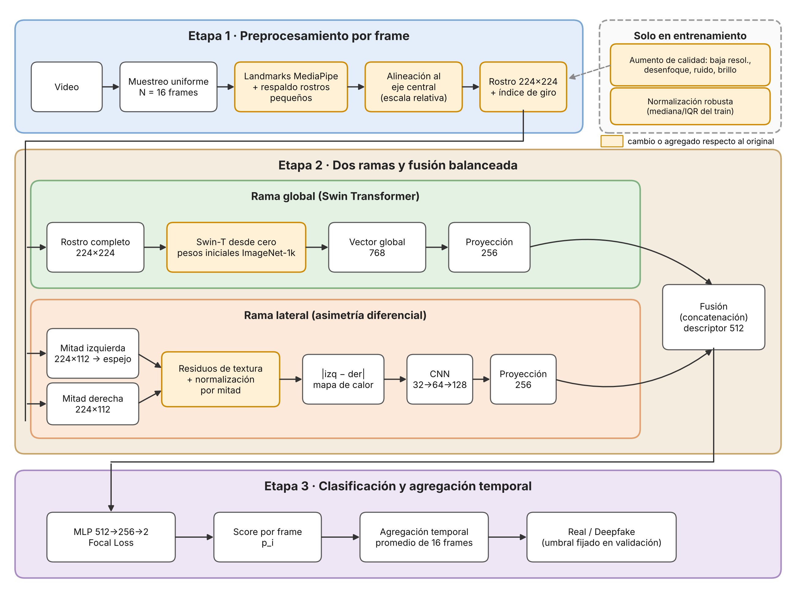

# Detección de deepfakes con Swin Transformer y asimetría diferencial lateral

Código de la tesis sobre detección de rostros manipulados en video robusta a la pérdida de calidad.
El detector combina dos ramas: un Swin Transformer que analiza el rostro completo y una CNN que analiza
el mapa de diferencias entre la mitad izquierda (en espejo) y la mitad derecha del rostro.

Todas las redes (Swin-T, CNN, MLP), sus gradientes y el optimizador están implementados en NumPy/CuPy,
sin PyTorch ni TensorFlow. En GPU se usa CuPy y en CPU NumPy, con el mismo código.

## Pipeline



El rostro del diagrama es un fotograma del video 003 de FaceForensics++ (Rössler et al., 2019).
Lo que cambió respecto al diseño inicial:

| Paso | Diseño inicial | Implementación actual | Motivo |
|---|---|---|---|
| Swin Transformer | pesos aleatorios | pesos iniciales de ImageNet-1k (Swin-T) | entrenado desde cero con 200 videos el AUC quedó en 0.50 |
| Mapa de asimetría | resta de píxeles | resta de residuos de textura, cada mitad normalizada por separado | la resta de píxeles respondía a la iluminación y la pose |
| Detección de rostro | MediaPipe | MediaPipe + detector de respaldo para rostros pequeños | dos videos sin rostro detectado |
| Alineación | recorte de al menos 224 px | recorte proporcional al rostro | rostros pequeños quedaban descentrados |
| Entrenamiento | — | aumento de calidad y normalización robusta (mediana/IQR del train) | robustez a baja calidad |

## Estructura

```
src/                     código fuente
  swin.py                Swin-T (atención por ventanas, ventanas desplazadas, patch merging)
  cnn.py, mlp.py         rama lateral y clasificador
  detector.py            ensamblado de las dos ramas y la fusión
  layers.py              capas con forward/backward (Linear, Conv2d, LayerNorm, BatchNorm, ...)
  losses.py, optim.py    Focal Loss, AdamW, tasa coseno
  pretrained.py          carga de pesos ImageNet (safetensors) sin PyTorch
  augment.py             degradaciones, aumento de datos, normalización, mapa de asimetría
  data.py                videos, MediaPipe, alineación, cachés, particiones
  ff_splits.py           partición oficial de FaceForensics++
  trainer.py             entrenamiento y evaluación
  metrics.py             AUC, F1, precisión, recall, EER, intervalos bootstrap
  experimento.py         protocolo en tres fases (preprocesar, entrenar, analizar)
  gradcheck.py           verificación numérica de los gradientes
  verificar_dataset.py   auditoría del dataset
  diagnostico_asimetria.py  análisis del mapa de asimetría
  verificar_swin_timm.py comparación con el Swin-T de timm
  build_notebook.py, build_fases.py, build_pruebas.py  generan los notebooks
  dibujar_pipeline.py    dibuja docs/pipeline.png a partir de un video
notebooks/               notebook principal, smoke test y pruebas por partes
kaggle/                  scripts para subir y ejecutar en Kaggle + notebooks de las fases
docs/                    diagrama, tablas, figuras de resultados y de las pruebas
```

## Instalación

```bash
python3 -m venv .venv && source .venv/bin/activate
pip install -r requirements.txt
# opcional, GPU NVIDIA con CUDA 12:
pip install cupy-cuda12x
```

Comprobar que los gradientes son correctos (menos de un minuto en CPU):

```bash
cd src && DF_BACKEND=numpy python gradcheck.py
```

## Pruebas por partes

[`notebooks/pruebas_por_partes.ipynb`](notebooks/pruebas_por_partes.ipynb) prueba cada componente por separado,
en el orden en que los datos recorren el pipeline. Cada sección imprime las dimensiones de los tensores y
termina con una comprobación `OK` o `FALLA`:

| # | Parte | Qué se comprueba |
|---|---|---|
| 1 | Preprocesamiento | rostro de 224×224×3 con valores en [0, 1] |
| 2 | Mapa diferencial | forma 224×112; un rostro simétrico da un mapa nulo; una alteración en una sola mejilla aparece justo en esa zona |
| 3 | PatchEmbed | (1, 3, 224, 224) → (1, 3136, 96); rechaza otras resoluciones |
| 4 | Partición en ventanas | 64 ventanas de 7×7; la reconstrucción es exacta |
| 5 | Ventanas desplazadas | máscara (64, 49, 49) con valores 0 y −100 |
| 6 | Window Attention | las filas de atención suman 1; la máscara bloquea regiones no contiguas |
| 7 | Patch Merging | 56×56×96 → 28×28×192 → 14×14×384 → 7×7×768 |
| 8 | Swin completo | forma de salida en cada bloque, vector 768 → 256, 27.5 M de parámetros |
| 9 | CNN lateral | (1, 3, 224, 112) → (1, 256), bloque por bloque |
| 10 | Fusión y Branch Dropout | vector de 512; cada rama se apaga ≈5 % de las veces y nunca en evaluación |
| 11 | MLP | 512 → 2; softmax suma 1; dropout solo en entrenamiento |
| 12 | Focal Loss | igual a la entropía cruzada con γ = 0; gradiente analítico = numérico; estable con logits extremos |
| 13 | Detector completo | forward y backward, ablaciones, máscara por giro y promedio de 16 fotogramas por video |
| 14 | Aprendizaje | con 16 ejemplos el modelo los memoriza (la pérdida baja y acierta el 100 %) |
| 15 | Calidad y normalización | degradación creciente por nivel; estadísticos calculados solo con train |
| 16 | Partición | 0 identidades compartidas entre train, val y test; reproducible con semilla 42 |
| 17 | Métricas | AUC, F1, precisión, recall, EER, matriz de confusión e intervalo bootstrap |
| 18 | Gradientes | backpropagation manual contra diferencias finitas (32 verificaciones) |

El notebook guardado ya tiene las salidas: **20 de 20 pruebas superadas** en CPU, en unos 2 minutos.
Las figuras están en [`docs/pruebas/`](docs/pruebas/).

Las salidas guardadas usan el video original 003 de FaceForensics++ (calidad c40): MediaPipe alinea un
fotograma real y ese rostro recorre todo el pipeline; la prueba de aprendizaje usa 8 fotogramas del mismo video.
Para repetirlo se indican el video y el modelo de MediaPipe con dos variables de entorno. Sin ellas, el notebook
usa un rostro sintético dibujado en código. Con `CARGAR_IMAGENET = True` la sección 8 carga los pesos de Swin-T.

```bash
pip install jupyter
cd notebooks
RUTA_ROSTRO=/ruta/a/original_sequences/youtube/c40/videos/003.mp4 \
RUTA_LANDMARKER=/ruta/a/face_landmarker.task \
DF_BACKEND=numpy jupyter notebook pruebas_por_partes.ipynb
```

En Kaggle basta con una celda inicial `!git clone https://github.com/JhonatanBilbao/deteccion-deepfakes-swin`
y abrir el notebook desde esa carpeta (busca `src/` automáticamente).

## Datos

No se incluyen videos. Se usa FaceForensics++ (Rössler et al., 2019), que se solicita a sus autores en
https://github.com/ondyari/FaceForensics. Se aceptan dos estructuras:

```
dataset/real/000.mp4                      dataset/original_sequences/youtube/c23/videos/000.mp4
dataset/fake/Deepfakes_000_003.mp4   o    dataset/manipulated_sequences/Deepfakes/c23/videos/000_003.mp4
```

La partición es la oficial de FF++ (720/140/140 videos originales): todos los videos de una persona,
reales y manipulados, quedan en el mismo conjunto. La normalización se ajusta solo con el train.
Si el dataset incluye la versión c40, sus videos de test se usan como prueba de baja calidad real.
Opcionalmente se evalúa en el test oficial de Celeb-DF v2.

Auditoría del dataset:

```bash
python src/verificar_dataset.py ruta/al/dataset
```

## Ejecución en Kaggle

Requiere la CLI de Kaggle con sesión iniciada (`kaggle auth login`).

```bash
export KAGGLE_USERNAME=tu_usuario
# prueba del flujo completo (10 videos por conjunto, 1 época)
bash kaggle/ejecutar_ffpp.sh --ffpp-dataset tu_usuario/tu-dataset --smoke
# protocolo completo: preprocesado (CPU), 6 entrenamientos (GPU T4) y análisis
bash kaggle/ejecutar_ffpp.sh --ffpp-dataset tu_usuario/tu-dataset
# con FF++ local, crea el dataset privado y ejecuta todo
bash kaggle/ejecutar_ffpp.sh --subir-ffpp /ruta/FaceForensics++ --celebdf-dataset tu_usuario/celeb-df
```

Modelos entrenados: `robusto_con_aumento` (propuesto, semillas 42, 7 y 123), `base_sin_aumento`,
`ablacion_solo_swin` y `ablacion_solo_asimetria`. Configuración: hasta 15 épocas con parada temprana
(paciencia 4), lote 16, AdamW, tasa 1e-4 (1e-5 en el Swin), Focal Loss (alfa 0.5, gamma 2), semilla 42.

## Resultados actuales

Subconjunto de FF++ con 200 videos (100 reales y 25 por cada técnica: Deepfakes, Face2Face, FaceSwap,
NeuralTextures), partición oficial: 151 de entrenamiento, 15 de validación y 34 de test.
AUC por video en test; entre corchetes, intervalo de confianza del 95 % por bootstrap de identidades.

| Modelo | Calidad buena | Regular | Mala | Muy mala | JPEG q30 (no visto) |
|---|---|---|---|---|---|
| Robusto (fusión + aumento), 3 semillas | 0.735 ± 0.061 | 0.745 | 0.719 | 0.640 | 0.767 |
| Base (fusión, sin aumento) | 0.718 [0.50–0.89] | 0.675 | 0.668 | 0.636 | 0.736 |
| Solo Swin | 0.786 [0.62–0.92] | 0.811 | 0.807 | 0.711 | 0.800 |
| Solo asimetría | 0.689 [0.55–0.86] | 0.654 | 0.579 | 0.582 | 0.675 |


- La rama de asimetría sola supera el azar (AUC 0.69); con el mapa por píxeles se quedaba en 0.41.
- El aumento de calidad mejora 0.12 de AUC en calidad mala respecto al modelo base, sin significancia (p ≈ 0.09).
- La fusión todavía no supera al Swin solo.
- Con 34 videos de test los intervalos son amplios (±0.15); estos números son preliminares.

Tablas completas en `docs/resultados/` y diagnóstico del mapa de asimetría en `docs/diagnostico_asimetria/`.

## Referencias

- Rössler et al., *FaceForensics++: Learning to Detect Manipulated Facial Images*, ICCV 2019.
- Liu et al., *Swin Transformer: Hierarchical Vision Transformer using Shifted Windows*, ICCV 2021.
- Li, Zhao y Cao, *Forensic Symmetry for DeepFakes*, IEEE TIFS, 2023.
- Lin et al., *Focal Loss for Dense Object Detection*, ICCV 2017.
- Pesos ImageNet: `timm/swin_tiny_patch4_window7_224.ms_in1k` (Hugging Face).
